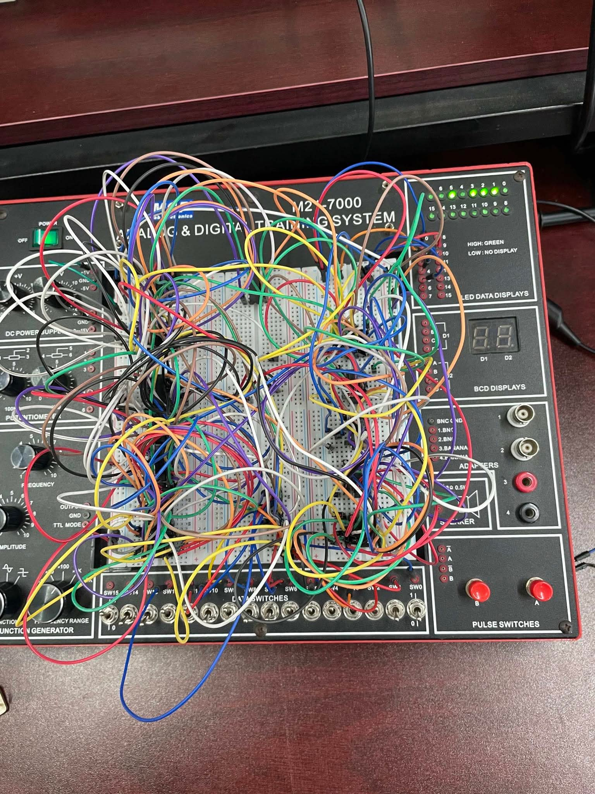
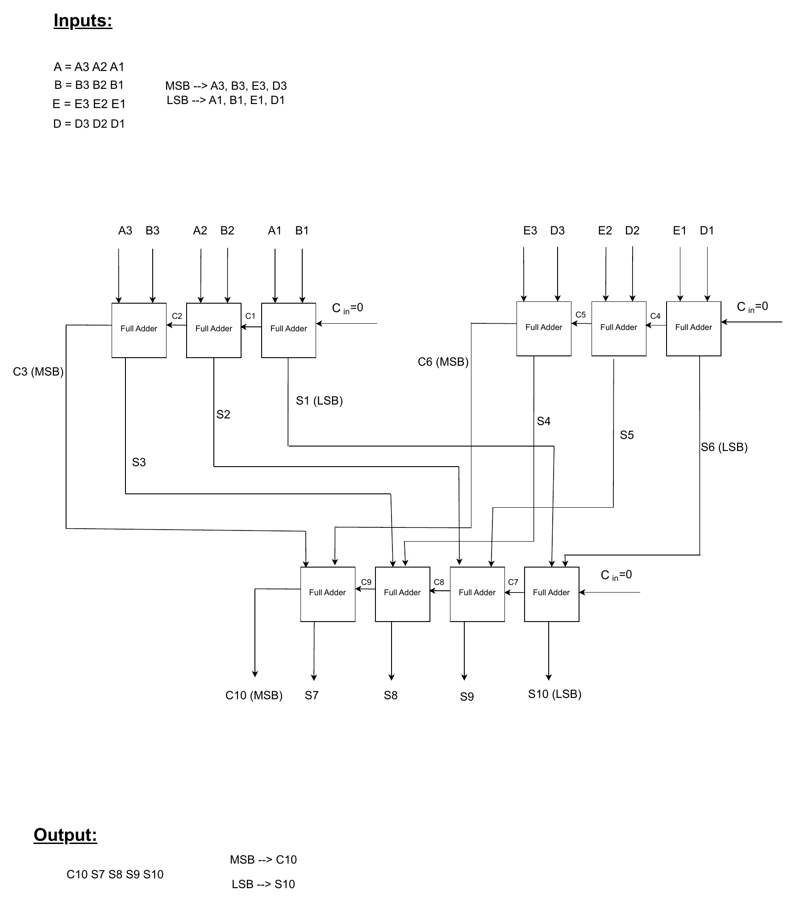
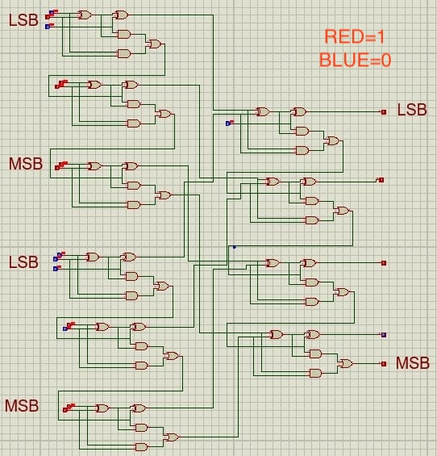

# Four 3-Bit Number Adder – Digital Logic Design Project

A combinational circuit that adds **four 3-bit binary numbers** and shows the
**5-bit sum**, built from basic logic gate ICs on a breadboard. Made for
CSE260 (Digital Logic Design) at BRAC University, Spring 2025.

  

## Problem

Build a circuit that adds four individual 3-bit numbers and displays the final
output, using only AND, OR, NOT, NAND, NOR, XOR and XNOR gates.

| Sample input | Expected output |
|--------------|-----------------|
| 110, 111, 110, 100 | 10111 |

See the [original task](images/project_task.png).

## Design

### Output width
Each 3-bit input is at most 7, so the largest possible sum is
7 + 7 + 7 + 7 = 28 (`11100`). The result therefore needs **5 bits**.

### Architecture
The circuit uses **10 full adders** arranged in two stages:

1. **Stage 1, two 3-bit ripple-carry adders working in parallel:**
   - A + B (full adders 1–3) produces a 4-bit partial sum `C3 S3 S2 S1`
   - E + D (full adders 4–6) produces a 4-bit partial sum `C6 S4 S5 S6`
2. **Stage 2, one 4-bit ripple-carry adder:**
   - Adds the two partial sums (full adders 7–10) to give the final
     5-bit result `C10 S7 S8 S9 S10`

Each full adder is built from basic gates:

- **Sum** = A ⊕ B ⊕ Cin (2 XOR gates)
- **Carry out** = A·B + Cin·(A ⊕ B) (2 AND gates and 1 OR gate)

### Block diagram

### Gate-level circuit
The full gate-level circuit was designed and simulated before building it
in hardware. In the simulation, red marks logic 1 and blue marks logic 0.

## Components

| Component | Quantity |
|-----------|----------|
| 7408 quad 2-input AND IC | 5 (20 AND gates) |
| 7486 quad 2-input XOR IC | 5 (20 XOR gates) |
| 7432 quad 2-input OR IC | 3 (10 of 12 OR gates used) |
| Breadboard | 1 |
| Digital trainer board | 1 |
| Jumper wires | As needed |

10 full adders × (2 XOR + 2 AND + 1 OR) = 20 XOR, 20 AND, and 10 OR gates.

## Building process

1. **Analyzed the problem:** worked out the input range and the 5-bit output width.
2. **Designed the architecture:** split the addition into two parallel 3-bit
   additions followed by a 4-bit addition (see the block diagram).
3. **Designed and simulated the circuit:** built the full gate-level circuit
   and checked it in simulation before wiring.
4. **Chose the ICs:** counted the gates needed and mapped them onto 7408,
   7486, and 7432 ICs.
5. **Built the hardware:** wired the ICs on a breadboard mounted on a digital
   trainer board, using the data switches for the 12 input bits and the LED
   displays for the 5 output bits.
6. **Tested it:** entered the given sample input and checked the LED output.

## Result

With the sample input `110 + 111 + 110 + 100` (6 + 7 + 6 + 4), the trainer
board LEDs show **`10111` (23)**, which matches the expected output.

| LED | 5 (MSB) | 4 | 3 | 2 | 1 (LSB) |
|-----|---------|---|---|---|---------|
| State | On | Off | On | On | On |
| Bit | 1 | 0 | 1 | 1 | 1 |

## Repository contents

| File | Description |
|------|-------------|
| [images/project_task.png](images/project_task.png) | Original project task |
| [images/block_diagram.png](images/block_diagram.png) | Full-adder block diagram |
| [images/circuit_diagram.jpeg](images/circuit_diagram.jpeg) | Gate-level circuit (simulation) |
| [images/hardware_output.jpeg](images/hardware_output.jpeg) | Working circuit showing the sample output |
| [docs/block_diagram.pdf](docs/block_diagram.pdf) | Block diagram (PDF) |
| [docs/components.pdf](docs/components.pdf) | Components list (PDF) |
| [docs/given_input_output.pdf](docs/given_input_output.pdf) | Given input and expected output (PDF) |
